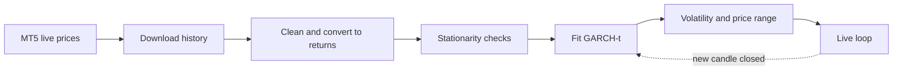

# 📈 Live GARCH Volatility Forecaster for MetaTrader 5

  

A Jupyter notebook that pulls prices from your **MT5 demo account**, checks the data, fits a **GARCH(1,1)** model, and then updates a **live chart + text** every time a candle closes.

> **What it forecasts:** how far price is likely to move (volatility), shown as a ±1σ range.
> **What it does NOT forecast:** whether price goes up or down. Use it for stop distance and position size, not as a buy/sell signal.

---

## 🚀 Quick start (5 steps)

1. **Open MT5**, log in to your demo account, and wait until prices are ticking.
2. **Install:** you need Windows and Python 3.10 or newer (developed on 3.13). Then run the two install cells (Steps 1–2 below).
3. **Run the cells top to bottom**, in the exact order listed in this README (the **Config cell must come first**).
4. In the *MT5 settings* cell, set `MT5_SYMBOL` to the name **exactly as shown in MT5 → Market Watch** (e.g. `XAUUSDm`).
5. Run the last cell and watch it update. Stop it with the **■ stop button**.

---

## 🗺️ How it works



---

## 🧩 The cells, in order

Click a step to open its instructions. **"Starts with"** is the first line of the cell, so you can find it.

<details>
<summary><b>Step 1 — Install MetaTrader5</b></summary>

**Starts with:** `pip install MetaTrader5`
**Do:** run it once. Use `%pip install -q MetaTrader5` if plain `pip` is not accepted.
**Expect:** `Successfully installed MetaTrader5`. Restart the kernel if it asks.
**If it fails:** "No matching distribution" → use Python 3.12 (the package is Windows-only and may lack a build for the newest Python).
</details>

<details>
<summary><b>Step 2 — Install the libraries</b></summary>

**Starts with:** `%pip install -q arch statsmodels seaborn scipy`
**Do:** run it once.
**Expect:** almost no output.
</details>

<details>
<summary><b>Step 3 — Config (imports + settings)</b> ⚠️ must run before the MT5 cells</summary>

**Starts with:** `import re`
**Do:** this is the only settings cell for the analysis. Defaults work for the MT5 flow.

| Setting | Meaning |
|---|---|
| `DATA_SOURCE` | `"csv"` (use this for MT5) or `"yfinance"` |
| `CSV_PATH` | file to read. Keep `"mt5_XAUUSDm_M1.csv"` (change `XAUUSDm` if your symbol differs) |
| `CSV_KIND` | `"auto"`, `"price"`, `"diff"` (price changes) or `"returns"` |
| `ANCHOR_PRICE` | last real price. Only needed for `diff` / `returns` files, to get price forecasts |
| `FORECAST_HORIZON` | how many bars ahead to forecast (default 15) |
| `DROP_SESSION_OPEN_BARS` | `True` for intraday data: drops the first bar after each overnight/weekend gap |

**Expect:** no output.
</details>

<details>
<summary><b>Step 4 — MT5 settings</b></summary>

**Starts with:** `import time`
**Do:** set the three lines at the top:

```python
MT5_SYMBOL       = "XAUUSDm"            # exactly as in Market Watch
MT5_TIMEFRAME    = mt5.TIMEFRAME_H1     # TIMEFRAME_M1, _M15, _H1, _H4, _D1
MT5_HISTORY_BARS = 10000                # bars to download for the model
```

**Expect:** no output. If you did not run Step 3 first, Step 5 fails with `NameError: name 'pd' is not defined`.
</details>

<details>
<summary><b>Step 5 — Download history</b></summary>

**Starts with:** `mt5_connect()`
**Do:** run it with MT5 open and logged in.
**Expect:** `Connected to MT5: <your server> | symbol: ...`, then a bar count, then `Saved: mt5_XAUUSDm_M1.csv`.
**Note:** the file name says `M1` even when you chose another timeframe. That is only a label. Step 3 expects this name.
</details>

<details>
<summary><b>Step 6 — Helper functions</b></summary>

**Starts with:** `# Helper functions (run once, nothing to edit)`
**Do:** run it. Nothing to edit. It contains the CSV reader, scaling, GARCH fitting and diagnostics.
**Expect:** no output.
</details>

<details>
<summary><b>Step 7 — Load data</b></summary>

**Starts with:** `# Load data -> df['Close']`
**Do:** run it.
**Expect:** a summary like `Input kind: price`, `Model series: Returns (bps)`, row count and date range, plus the first rows.
**Check:** the row count and dates look right. Rows removed after time gaps are reported.
</details>

<details>
<summary><b>Step 8 — Stationarity check</b></summary>

**Starts with:** `# Stationarity check on the series GARCH will model`
**Expect:** `VERDICT: STATIONARY - ready for GARCH.`
**If it says NOT stationary:** check `CSV_KIND` in Step 3 (`price`, `diff` or `returns`) and re-run from Step 7.
</details>

<details>
<summary><b>Steps 9–15 — Look at the data (7 small cells)</b></summary>

Run them in this order. They only draw charts.

| # | Starts with / contains | What it shows | What to look for |
|---|---|---|---|
| 9 | `plt.figure(...)` + `df["Close"]` | price over time | the overall trend |
| 10 | `plt.figure(...)` + `df["Series"]` | the returns GARCH models | calm and wild periods, grouped together |
| 11 | `sns.histplot` | histogram vs normal curve | taller middle and fatter tails than the red curve |
| 12 | `probplot(...)` | QQ plot | dots curling away at both ends = fat tails |
| 13 | `plt.figure(...)` + `df["Squared"]` | squared returns | bursts of large values = volatility clusters |
| 14 | `LAGS = max(5, ...` | ACF / PACF of returns | usually small |
| 15 | `fig, axes = ...` + `df["Squared"]` | ACF / PACF of squared returns | bars above the blue band, fading slowly = GARCH suits this data |
</details>

<details>
<summary><b>Steps 16–19 — Fit the models</b></summary>

| # | Starts with | Expect |
|---|---|---|
| 16 | `# GARCH(1,1) with Normal innovations` | a model summary table |
| 17 | `residual_diagnostics(model_fit, ...` | residual charts and Ljung-Box tests (are leftover patterns gone?) |
| 18 | `# GARCH(1,1) with Student's t innovations` | summary, a **Normal vs Student-t** table (lower AIC/BIC wins), and `Persistence (alpha + beta) = ...` |
| 19 | `residual_diagnostics(model_fit_t, ...` | same diagnostics for the t model |

**How to read it:** the t model usually wins for market data. Persistence close to 1 (e.g. 0.995) means volatility shocks fade slowly.
</details>

<details>
<summary><b>Step 20 — Volatility forecast</b></summary>

**Starts with:** `# Volatility forecast`
**Expect:** a table of expected volatility for each of the next 15 bars, in the model's units (for example bps per bar), plus a chart.
</details>

<details>
<summary><b>Step 21 — Price range forecast</b></summary>

**Starts with:** `# Prediction interval for the price`
**Expect:** a table with `Expected Price`, `Lower Bound (1-sigma)` and `Upper Bound (1-sigma)` for each bar ahead, and a chart. The range widens the further ahead you look. Set `Z = 1.96` in the cell for a ~95% band.
</details>

<details open>
<summary><b>Step 22 — 🔴 LIVE loop (last cell)</b></summary>

**Starts with:** `# MT5: LIVE loop`
**Do:** run it and leave it running. **Stop with the ■ button.** It never finishes on its own, so do not "Run All" and wait for it.

**How it behaves**
- Every 10 seconds (`POLL_SECONDS`) it refreshes the screen with the **live price**.
- The model is **refitted only when a new candle closes**.
- Hourly bars give one new model per hour. Use `TIMEFRAME_M15` or `TIMEFRAME_M1` in Step 4 for faster updates.

**What you will see**

| Line | Meaning |
|---|---|
| `LIVE price` | mid of bid and ask, and minutes left in the running candle |
| `Close range from LIVE price` | where the running candle is likely to close (about 2 chances in 3), narrowing as time runs out |
| `Close range from last CLOSE` | the same idea, but fixed from the candle's open. Keep it to check the model later |
| `Next-bar volatility` | expected size of one candle's move, in % and in price, with a percentile vs the last ~5000 bars |
| `Regime` | **HIGH** above the 80th percentile, **LOW** below the 20th, otherwise **NORMAL** |
| `15-bar 1-sigma band` | price range 15 bars ahead (15 minutes on M1, 15 hours on H1) |
| table at the bottom | one row per closed candle, newest on top |

Tunable settings are at the top of the cell: `LIVE_BARS`, `LIVE_HORIZON`, `POLL_SECONDS`, `LOG_ROWS`.
</details>

---

## 🕒 Good to know

- **Times are broker server time.** For many brokers this equals UTC, which is 5h30 behind IST. A difference between the chart time and your clock is not a delay.
- **Bar times are the candle's start.** The bar stamped `15:00` on H1 covers 15:00–16:00. The last *closed* bar is always one behind the running candle.
- **1-minute data is hard to use.** Gold's spread can be a large part of a 1-minute move, and GARCH(1,1) does not know the time of day. M15 or H1 is the safer starting point.
- **Using your own CSV instead of MT5?** Set `CSV_PATH` in Step 3 and skip Steps 1, 4 and 5. It accepts price files, differenced files and returns files.

<details>
<summary><b>🛠️ Troubleshooting</b></summary>

| Problem | Fix |
|---|---|
| `ModuleNotFoundError: MetaTrader5` | run Step 1; the package is Windows-only; try Python 3.12 if no wheel exists |
| `NameError: name 'pd'` / `'prepare'` / `'mt5_connect'` is not defined | an earlier cell was not run. Run in order from Step 3, or restart the kernel and run top to bottom |
| `MT5 initialize failed` | open the MT5 terminal, log in, wait for prices to tick, then re-run |
| `Symbol '...' not found` | copy the name exactly from Market Watch (`EURUSDm`, `XAUUSD.a`, ...) |
| A cell shows `[*]` and nothing happens | the live loop is still running and later cells wait behind it. Press **■**, or restart the kernel |
| Live price says "market closed?" | no fresh ticks (weekend or break). Normal |
| Charts or numbers look odd after changing timeframe | re-run Steps 5 → 22 so the new data is used |

</details>

---

⚠️ **Educational use only. Not financial advice.** Test on a demo account. A forecast of volatility is not a prediction of price direction, and real trading carries risk of loss.
